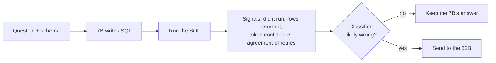
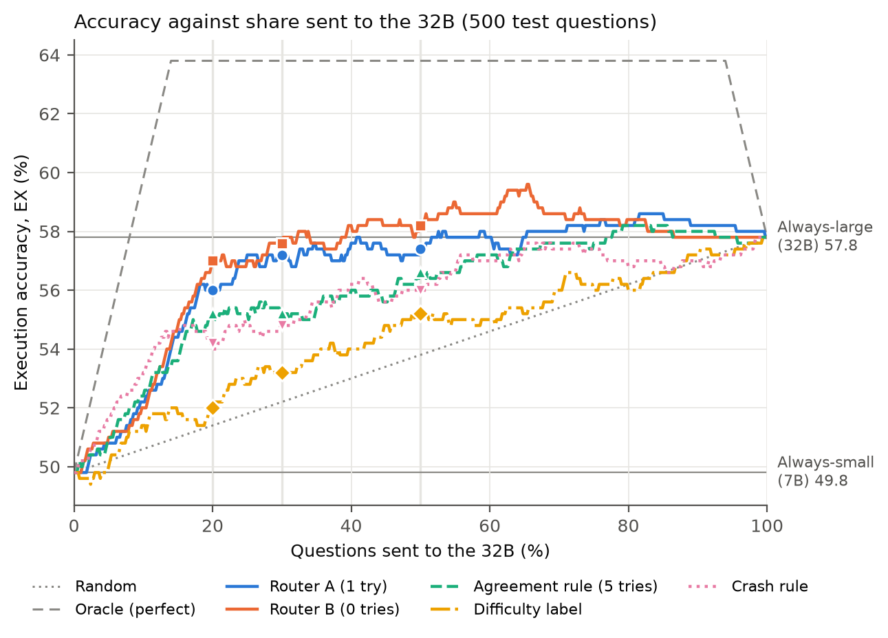
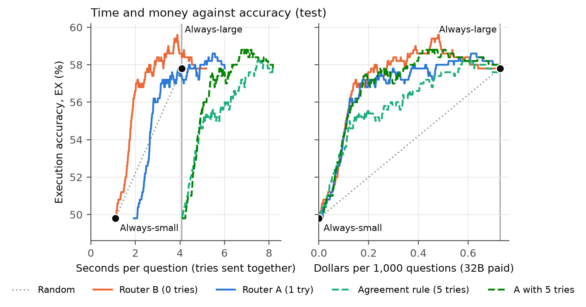
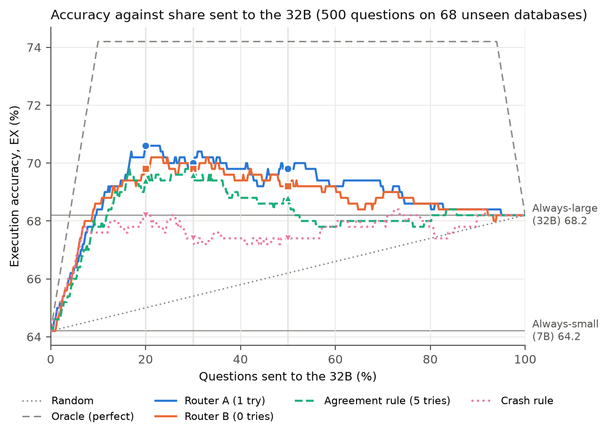

# Run It, Then Route It: Execution-Based Routing Between Small and Large LLMs for Text-to-SQL

Andrew Shilman and David Cho, San José State University, Fall 2026

[](requirements.txt) [](LICENSE)

- **Same accuracy as the 32B for 29% of its cost.** Router B sends 30% of BIRD Mini-Dev questions to the 32B and matches always-32B (57.80 EX), in 62% of its time.
- **Works on databases it has never seen.** On 500 questions from 68 unseen BIRD databases, the frozen router beats random by 3.6 to 5.6 points and scores above always-32B (70.60 vs. 68.20 EX) while escalating 20%.
- **Pre-registered.** Every routing choice was committed before each test run, and [`docs/Journal.md`](docs/Journal.md) logs every run, number and decision with its date.

A small local model answers every text-to-SQL question first. A classifier then predicts whether that answer is wrong, using signals that exist only after the SQL has been run: whether it executed, what it returned, the model's token log-probabilities, and how often repeated samples return the same result. Questions the classifier flags are escalated to a larger model. We compare this router against random routing, BIRD's difficulty label, simple execution rules, always-small, always-large and an oracle on BIRD Mini-Dev (SQLite, 500 questions), and then on 500 questions from 68 BIRD databases the router never saw in training.



## Main results

Test set: the 500 BIRD Mini-Dev questions, scored once with every choice frozen in advance. Small model: Qwen2.5-Coder-7B. Large model: Qwen2.5-Coder-32B. EX is the official Mini-Dev execution accuracy (400 s time limit).

| Router | EX at 20% escalated | 30% | 50% | Share needed to match always-large |
| --- | --- | --- | --- | --- |
| Always-small (7B) | 49.80 | | | |
| Random | 51.40 | 52.20 | 53.80 | 100% |
| Difficulty label | 52.00 | 53.20 | 55.20 | 99% |
| Agreement rule (at most 2 of 5 samples agree) | 55.20 | 55.20 | 56.60 | 77% |
| Router A: is the 7B wrong? (logistic regression, 1 extra sample) | 56.00 | 57.20 | 57.40 | 41% |
| Router B: will escalating fix it? (gradient boosting, no extra samples) | 57.00 | 57.60 | 58.20 | 30% |
| Oracle | 63.80 | 63.80 | 63.80 | 8% |
| Always-large (32B) | | | | 57.80 at 100% |



- Router A beats random by 4.6 points at 20% escalated (paired bootstrap 95% CI +2.7 to +6.6) and the agreement rule by 2.6 points at that rule's own share of 34.6% (57.60 vs. 55.00, McNemar p = 0.019).
- A router that sees only the question, before any SQL is generated, does no better than random (50.80 at 20%).
- Extra samples add little: router A's mean EX over 10 to 50% escalated is 56.37, 56.41, 56.48 and 56.54 with 0, 1, 3 and 5 samples.
- B vs. A is within noise at every share.

Cost per question at the first share that matches always-large's EX (Apple M5 Max, Ollama, dollars as if only the 32B were a paid API at $0.66 / $1.00 per million input / output tokens):

| Router | Seconds per question | Dollars per 1,000 questions |
| --- | --- | --- |
| Router B (0 extra samples) | 2.52 (62% of always-large) | 0.21 (29%) |
| Router A (1 extra sample) | 3.96 (97%) | 0.30 (41%) |
| Agreement rule at its own share (5 samples, sent in parallel) | 5.77 (141%) | 0.25 (35%) |
| Always-large | 4.09 | 0.73 |

Sending the extra samples to the server in parallel saves 3% of the time with 1 sample and 31% with 5, so routers that rely on repeated sampling save money but not time.



## Databases the router has never seen

Training and Mini-Dev share the same 11 databases. To test transfer, we drew 500 questions from BIRD's training set (at most 8 per database, 68 databases, none shared with the 11) after dropping questions whose gold SQL visibly fails, and routed them with the same frozen routers, without retraining. Every choice and three hypotheses were committed before any model was run on these questions. BIRD's training questions have no difficulty label, so there is no difficulty baseline here.

| Router | EX at 20% escalated | 30% | 50% | Share needed to match always-large |
| --- | --- | --- | --- | --- |
| Always-small (7B) | 64.20 | | | |
| Random | 65.00 | 65.40 | 66.20 | 100% |
| Crash rule | 68.20 | 67.40 | 67.40 | 20% |
| Agreement rule (at most 2 of 5 samples agree) | 69.40 | 69.60 | 68.80 | 12% |
| Router A (1 extra sample) | 70.60 | 70.00 | 69.80 | 9% |
| Router B (no extra samples) | 69.80 | 69.80 | 69.20 | 9% |
| Oracle | 74.20 | 74.20 | 74.20 | 4% |
| Always-large (32B) | | | | 68.20 at 100% |



- Router A beats random by 5.6, 4.6 and 3.6 points at 20, 30 and 50% escalated (95% CIs +3.8 to +7.5, +2.7 to +6.6 and +1.9 to +5.3), about the same as on Mini-Dev although the 32B's lead over the 7B is half as large (4.0 vs. 8.0 points). Resampling whole databases instead of questions gives nearly the same intervals.
- Routing beats always-large: the 32B breaks 30 answers the 7B had right, so router A at 20% (70.60) is above always-large (68.20).
- Router A does not beat the agreement rule here: +0.8 at the rule's own share of 18.4% (p = 0.45).

The same routing curve on the training questions and ROC-AUC against the number of samples are in [`figures/`](figures/), as PDF and PNG.

Full numbers, every frozen decision and the date it was made are in [`docs/Journal.md`](docs/Journal.md). The original plan is in [`docs/proposal.pdf`](docs/proposal.pdf).

## Method

- **Models.** Qwen2.5-Coder 7B and 32B (4-bit `Q4_K_M` builds) served by Ollama, with the official Mini-Dev prompt, temperature 0, a 16,384-token context and a 1,024-token reply cap.
- **Targets.** A: the 7B's answer is wrong. B: the 7B is wrong and the 32B is right.
- **Features.** 46 per question, all available before the 32B is called: question and schema statistics, whether the 7B's SQL executed and what it returned, token log-probabilities, and agreement among k samples at temperature 0.7 (k = 1 to 5). BIRD's difficulty label is never a feature.
- **Training.** 1,034 BIRD dev questions not in Mini-Dev (removed by `question_id`), labeled against the dev databases. Logistic regression, random forest and gradient boosting with class weights, 5-fold cross-validation and nested tuning over 3 seeds, plus leave-one-database-out. The final classifiers and the comparison rules were chosen on training only, rehearsed end to end on out-of-fold scores, and recorded before the test set was scored.
- **Evaluation.** Each router ranks the test questions and escalates the top share. Correctness comes from the saved answers of both models, so no model is rerun during routing. EX and Soft F1 come from the official Mini-Dev scripts, and routers are compared with a paired bootstrap (10,000 resamples) and McNemar's exact test.

## Experiments

| | Question | Script | Output |
| --- | --- | --- | --- |
| E1 | How good is each model alone? | `generate.py`, official scorers | `outputs/eval_*.txt` |
| E2 | Which classifier type predicts failures best? | `train.py --exp e2` | `outputs/e2_results.csv` |
| E3 | Which features matter, and how many samples are worth it? | `train.py --exp e3` | `outputs/e3_results.csv` |
| E4 | Accuracy against share escalated, with paired tests | `route.py --mode final` | `outputs/e4_*.csv`, routed `e4_*.json` |
| E5 | Seconds and dollars per router | `timing.py`, `cost.py` | `outputs/e5_*.csv` |
| E6 | Does routing transfer to databases never seen in training? | `make_unseen.py`, `route.py --mode final`, `unseen_stats.py` | `outputs/e6_*.csv`, routed `e6_*.json` |

## Repository

```text
scripts/
  rebuild_gold.py   rebuild Mini-Dev questions and gold SQL from the Hugging Face copy
  gold_check.py     score the gold SQL as predictions (must give EX 100.00)
  make_train.py     BIRD dev minus Mini-Dev, matched by question_id
  generate.py       model answers through Ollama, cached per question
  check.py          per-question right/wrong, same rule and time limit as the official scorer
  features.py       one feature row per question
  train.py          cross-validated classifiers (E2, E3)
  route.py          routing curves, rule baselines and paired tests (rehearsal, E4, E6)
  timing.py         timing run for E5 (samples sequential vs. parallel)
  cost.py           seconds, tokens and dollars per router (E5)
  make_unseen.py    sample BIRD train questions on databases never seen in training (E6)
  unseen_stats.py   database-level bootstrap, ROC-AUC and schema-size subset (E6)
  plots.py          figures (writes figures/)
figures/            routing curves (test, training, unseen databases), ROC-AUC by samples, cost, social preview card
docs/
  Journal.md        research log: every run, result and frozen decision
  proposal.pdf      project proposal
```

`data/`, `outputs/` and `mini_dev/` are not tracked.

## Setup

Python 3.11 and Ollama. Running the 32B needs at least 32 GB of memory (we used an Apple M5 Max with 64 GB).

```bash
git clone https://github.com/Ashilman25/text2sql-router.git && cd text2sql-router
git clone https://github.com/bird-bench/mini_dev.git        # official prompt and evaluation code
python3.11 -m venv .venv && source .venv/bin/activate
pip install -r requirements.txt
ollama pull qwen2.5-coder:7b && ollama pull qwen2.5-coder:32b
```

Data layout:

```text
data/minidev/dev_databases/<db_id>/<db_id>.sqlite   Mini-Dev package (minidev/MINIDEV/ from minidev_0703.zip)
data/minidev/mini_dev_sqlite.json                   rebuilt by rebuild_gold.py
data/minidev/mini_dev_sqlite_gold.sql               rebuilt by rebuild_gold.py
data/dev/dev_databases/<db_id>/<db_id>.sqlite       BIRD dev (dev.zip)
data/dev/dev.json                                   BIRD dev questions
data/dev/train.json                                 written by make_train.py
data/train/train_databases/<db_id>/<db_id>.sqlite   BIRD train (train.zip, 69 databases, 30 GB), only for E6
data/train/train.json                               BIRD train questions
data/train/unseen.json                              written by make_unseen.py (the 500 E6 questions)
```

```bash
python scripts/rebuild_gold.py data/minidev
python scripts/gold_check.py data/minidev
python scripts/make_train.py data/dev/dev.json data/minidev/mini_dev_sqlite.json data/dev/train.json
```

## Reproducing the experiments

Model runs (about 4 hours on an M5 Max). Each `--out` writes a resumable cache (`.jsonl`) and a predictions file in the scorer's format (`.json`).

```bash
M=data/minidev/mini_dev_sqlite.json; MDB=data/minidev/dev_databases
T=data/dev/train.json;              TDB=data/dev/dev_databases

for model in 7b 32b; do
  python scripts/generate.py --questions $M --db_root $MDB --model qwen2.5-coder:$model --out outputs/minidev_qwen$model
  python scripts/generate.py --questions $T --db_root $TDB --model qwen2.5-coder:$model --out outputs/train_qwen$model
done
python scripts/generate.py --questions $M --db_root $MDB --model qwen2.5-coder:7b --logprobs --out outputs/minidev_qwen7b_lp
python scripts/generate.py --questions $T --db_root $TDB --model qwen2.5-coder:7b --logprobs --out outputs/train_qwen7b_lp
python scripts/generate.py --questions $M --db_root $MDB --model qwen2.5-coder:7b --samples 5 --temperature 0.7 --out outputs/minidev_qwen7b_s5
python scripts/generate.py --questions $T --db_root $TDB --model qwen2.5-coder:7b --samples 5 --temperature 0.7 --out outputs/train_qwen7b_s5
```

Correctness labels, features, classifiers and routing:

```bash
for set in minidev train; do
  if [ $set = minidev ]; then Q=$M; DB=$MDB; else Q=$T; DB=$TDB; fi
  for run in qwen7b qwen32b qwen7b_s5; do
    python scripts/check.py --questions $Q --db_root $DB --cache outputs/${set}_$run.jsonl
  done
  python scripts/check.py --questions $Q --db_root $DB --cache outputs/${set}_qwen7b_s5.jsonl \
    --ref outputs/${set}_qwen7b.jsonl --out outputs/${set}_qwen7b_s5_vs_t0_check.jsonl
done

python scripts/features.py --questions $T --db_root $TDB --runs outputs/train   --out outputs/features_train.csv
python scripts/features.py --questions $M --db_root $MDB --runs outputs/minidev --out outputs/features_test.csv

python scripts/train.py --exp e2 --out outputs/e2_results.csv --scores_out outputs/e2_scores.csv
python scripts/train.py --exp e3 --out outputs/e3_results.csv --scores_out outputs/e3_scores.csv

python scripts/route.py --features outputs/features_train.csv --runs outputs/train --scores outputs/e3_scores.csv --out outputs/rehearsal
python scripts/route.py --mode final --features outputs/features_train.csv --test_features outputs/features_test.csv \
  --runs outputs/minidev --agree_rule 2 --out outputs/e4
```

Official scoring of any predictions file. Keep the trailing `/` on `--db_root_path`. `evaluation_f1.py` takes the same arguments.

```bash
python mini_dev/evaluation/evaluation_ex.py \
  --predicted_sql_path outputs/e4_a_lr_plus_agree_k1_20.json \
  --ground_truth_path data/minidev/mini_dev_sqlite_gold.sql \
  --db_root_path data/minidev/dev_databases/ \
  --diff_json_path data/minidev/mini_dev_sqlite.jsonl \
  --sql_dialect SQLite --num_cpus 8 --meta_time_out 400 \
  --output_log_path outputs/eval_e4_a_20.txt
```

Time and cost (E5). The parallel passes need a server started with `OLLAMA_NUM_PARALLEL=6`, the others the default server, both with `OLLAMA_FLASH_ATTENTION=1 OLLAMA_KV_CACHE_TYPE=q8_0`:

```bash
python scripts/timing.py --questions $M --db_root $MDB --passes together_1,together_3,together_5 --out outputs/timing_minidev.jsonl
python scripts/timing.py --questions $M --db_root $MDB --passes sequential,large --out outputs/timing_minidev.jsonl
python scripts/cost.py --timing outputs/timing_minidev.jsonl --price_in 0.66 --price_out 1.00 --out outputs/e5
```

Unseen databases (E6). `make_unseen.py` runs every gold query (about 12 minutes), drops unusable questions and writes the 500 sampled questions, their gold SQL and a scorer file whose difficulty labels are placeholders, because the official scorer needs every group non-empty. Only its total is used. The model runs take about 1.5 hours.

```bash
U=data/train/unseen.json; UDB=data/train/train_databases
python scripts/make_unseen.py data/train
python scripts/generate.py --questions $U --db_root $UDB --model qwen2.5-coder:7b --logprobs --out outputs/unseen_qwen7b
cp outputs/unseen_qwen7b.jsonl outputs/unseen_qwen7b_lp.jsonl
python scripts/generate.py --questions $U --db_root $UDB --model qwen2.5-coder:7b --samples 5 --temperature 0.7 --out outputs/unseen_qwen7b_s5
python scripts/generate.py --questions $U --db_root $UDB --model qwen2.5-coder:32b --out outputs/unseen_qwen32b
for run in qwen7b qwen32b qwen7b_s5; do
  python scripts/check.py --questions $U --db_root $UDB --cache outputs/unseen_$run.jsonl
done
python scripts/check.py --questions $U --db_root $UDB --cache outputs/unseen_qwen7b_s5.jsonl \
  --ref outputs/unseen_qwen7b.jsonl --out outputs/unseen_qwen7b_s5_vs_t0_check.jsonl
python scripts/features.py --questions $U --db_root $UDB --runs outputs/unseen --out outputs/features_unseen.csv
python scripts/route.py --mode final --features outputs/features_train.csv --test_features outputs/features_unseen.csv \
  --runs outputs/unseen --agree_rule 2 --out outputs/e6
python scripts/unseen_stats.py --test_features outputs/features_unseen.csv --scores outputs/e6_scores.csv \
  --runs outputs/unseen --out outputs/e6_stats.csv
```

Official scoring uses `--ground_truth_path data/train/unseen_gold.sql --db_root_path data/train/train_databases/ --diff_json_path data/train/unseen_scorer.jsonl`. Then draw every figure:

```bash
python scripts/plots.py
```

## Notes on the data

- **Gold SQL.** The Mini-Dev package's `mini_dev_sqlite_gold.sql` matches its question file on 494 of 500 lines: questions 129, 137 and 138 have rotated answers, and 119, 120 and 1322 carry an extra database name that breaks the scorer. `rebuild_gold.py` rebuilds both files from the maintained Hugging Face copy (`birdsql/bird_mini_dev`).
- **Two database versions.** 5 of the 11 databases (california_schools, european_football_2, formula_1, thrombosis_prediction, toxicology) have different rows in the Mini-Dev and dev downloads. 23 Mini-Dev and 82 dev gold queries return different results across the two, so each question set is run against its own databases.
- **Time limit.** At the official 30 s per question, the gold SQL for questions 701 (about 100 s) and 518 (about 20 s) times out, so the gold check scores 99.60. We score at 400 s, where it scores 100.00.
- **Reworded questions.** 4 Mini-Dev questions are worded differently from their dev versions, so the training set removes Mini-Dev by `question_id`, not by text.
- **BIRD train gold.** BIRD's training set is less curated than dev. 330 of `retail_world`'s 373 gold queries reference tables and columns that its database doesn't have, 283 gold queries return no rows (dev has none), 53 return only NULL, and 123 use `LIMIT` without `ORDER BY`. `make_unseen.py` drops these, plus gold errors, timeouts and conflicting duplicates (857 questions in all) before sampling.

## Acknowledgments

The prompt builder (`mini_dev/llm/src/prompt.py`) and the evaluation scripts (`evaluation_ex.py`, `evaluation_f1.py`) are used unmodified from the [BIRD Mini-Dev repository](https://github.com/bird-bench/mini_dev). BIRD and BIRD Mini-Dev are released under CC BY-SA 4.0.

- J. Li et al. Can LLM Already Serve as a Database Interface? A BIg Bench for Large-Scale Database Grounded Text-to-SQLs. NeurIPS 2023 Datasets and Benchmarks.
- B. Hui et al. Qwen2.5-Coder Technical Report. arXiv:2409.12186, 2024.

To cite this repository, use GitHub's "Cite this repository" button (from [`CITATION.cff`](CITATION.cff)).

The code in this repository is MIT licensed (see [`LICENSE`](LICENSE)). BIRD and BIRD Mini-Dev data are not included and remain under CC BY-SA 4.0.
